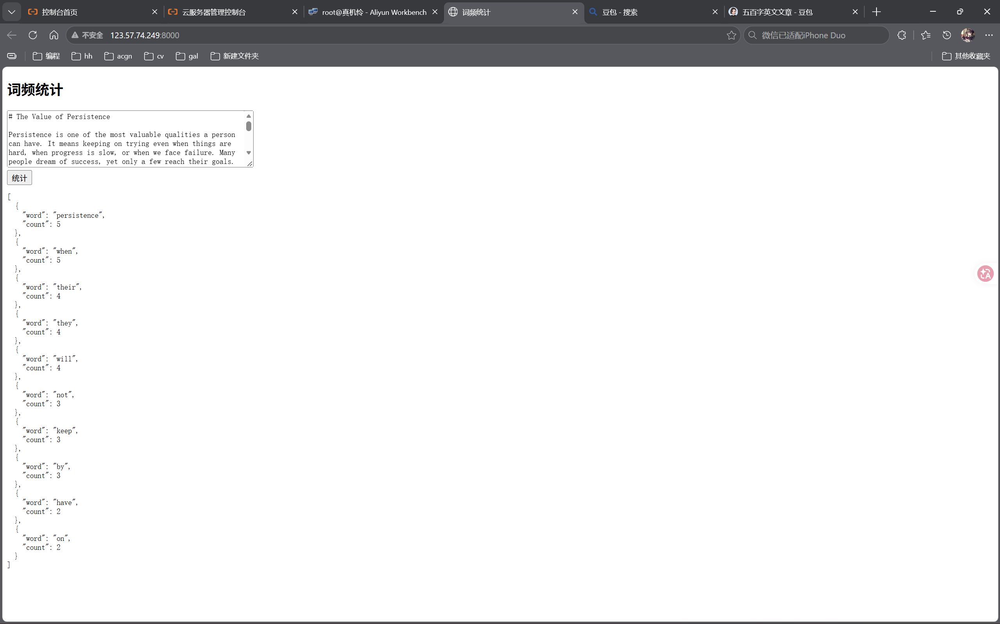
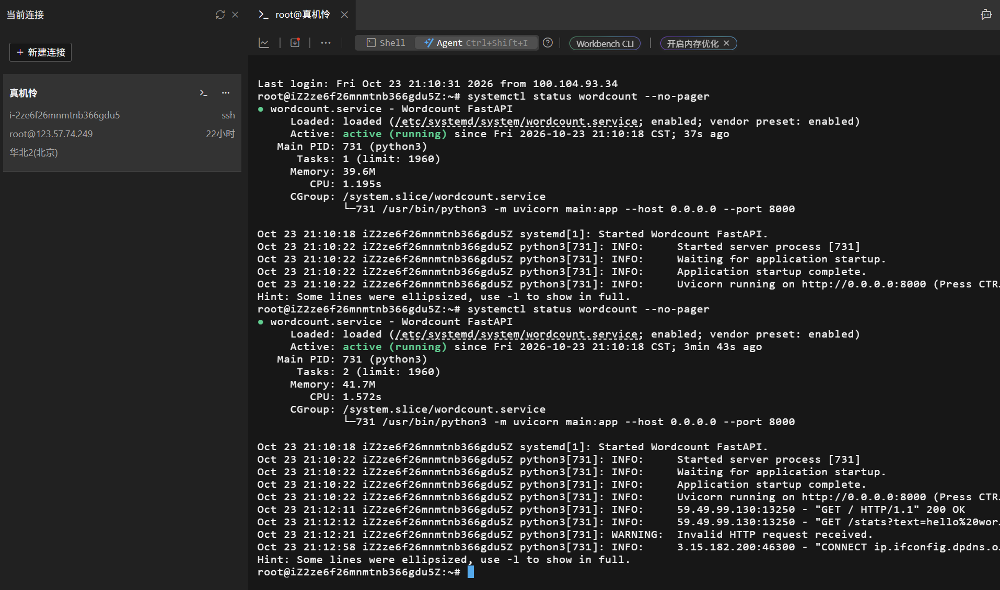

# 词频统计 Web 服务（learning-log）

Python 转就业学习记录 —— W2 交付物：一个能公网访问的词频统计服务。

- 在线演示：<http://123.57.74.249:8000>
- 部署环境：阿里云 ECS / Ubuntu 22.04 / systemd 常驻
- 技术栈：Python 3.10 · FastAPI · Uvicorn



## 功能

- 浏览器输入一段英文文本，点「统计」，返回出现次数最多的前 10 个单词
- 统计规则：统一转小写、去掉单词两端标点、过滤常见停用词（the / a / of …）
- 同一个服务对外提供 JSON 接口，页面通过 `fetch` 调用

## 接口

| 方法 | 路径 | 说明 |
|---|---|---|
| GET | `/` | 极简页面：输入框 + 统计按钮 |
| GET | `/stats?text=...` | 返回词频 JSON |

```bash
curl -s "http://123.57.74.249:8000/stats?text=hello%20world%20hello"
```

返回：

```json
{"top": [{"word": "hello", "count": 2}, {"word": "world", "count": 1}]}
```

## 项目结构

```
learning-log/
├── main.py            # FastAPI 应用：/ 页面 + /stats 接口
├── index.html         # 极简页面（输入框 + 按钮 + JS fetch）
├── wordcount.py       # W1 命令行版词频统计（文件 IO / argparse）
├── Data/sample.txt    # 示例文本
├── LeetCode/          # 刷题记录
└── docs/              # 截图
```

## 本地运行

```bash
python3 -m pip install fastapi uvicorn
python3 -m uvicorn main:app --host 0.0.0.0 --port 8000
```

## 服务器部署

代码位于 `/root/learning-log`，用 systemd 管理（开机自启、崩溃自动重启）：

```bash
systemctl status wordcount      # 查看状态
journalctl -u wordcount -n 30   # 查看日志
systemctl restart wordcount     # 改完代码后重启
```

服务配置文件：`/etc/systemd/system/wordcount.service`



## 学习日志

- W1：Python 基础 —— 猜数字、成绩统计、命令行词频统计；LeetCode 3 题
- W2：FastAPI 最小接口 → `/stats` 词频接口 → 公网访问 → 极简页面 → systemd 常驻
